<p align="center">
  
</p>

<h1 align="center">Blushme</h1>

<p align="center">
  A private, Vietnamese-first cycle journal.<br />
  Track your period, understand your cycle and see what to pay attention to each day.
</p>

<p align="center">
  
</p>

> Blushme gives estimates based on your own logs. It is not a medical tool and is not a contraceptive. Talk to a doctor if anything worries you.

## At a glance

| | |
| --- | --- |
| **Language** | Vietnamese by default, English available |
| **Platform** | Installable web app (PWA) for phone and desktop |
| **Accounts** | Email and password, powered by Supabase |
| **Privacy** | Per-user row level security, no ads, no analytics |
| **Try it** | "Sử dụng tài khoản demo" on the sign-in page, no sign-up needed |

## Install the app on your device

Blushme is a progressive web app (PWA), so there is nothing to download from an app store. Open the site in your browser and add it to your device.

| | Device | Browser | Steps |
| --- | --- | --- | --- |
| 🍎 | **iPhone / iPad** | 🧭 Safari | Tap **Share** ⬆️, then **Add to Home Screen** ➕, then **Add** |
| 🤖 | **Android** | 🌐 Chrome | Tap the **⋮** menu, then **Install app** 📲 (or **Add to Home screen**) |
| 🖥️ | **Windows / macOS / Linux** | 🌐 Chrome or Edge | Click the **install icon** ⬇️ at the right of the address bar, then **Install** |

✅ After installing, Blushme opens in its own window like a native app.

## Screenshots

<table>
  <tr>
    <td align="center">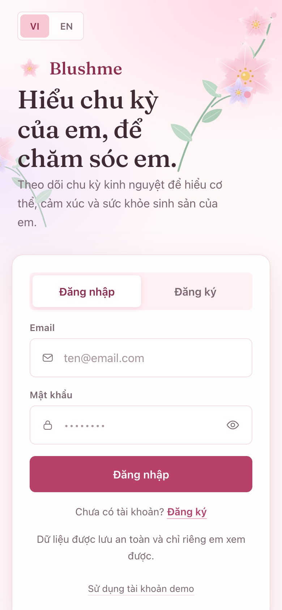<br /><sub><b>Sign in</b><br />Email and password, plus a one-tap demo</sub></td>
    <td align="center">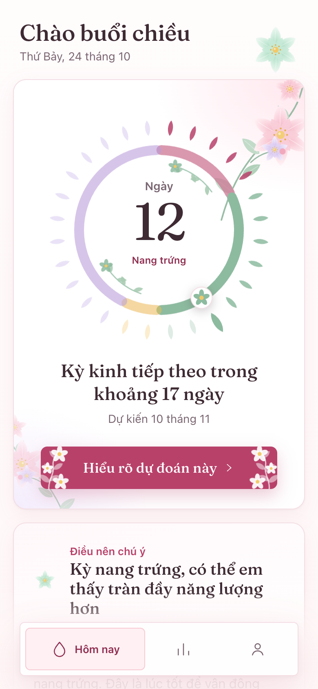<br /><sub><b>Today</b><br />Cycle day, phase and next period</sub></td>
    <td align="center">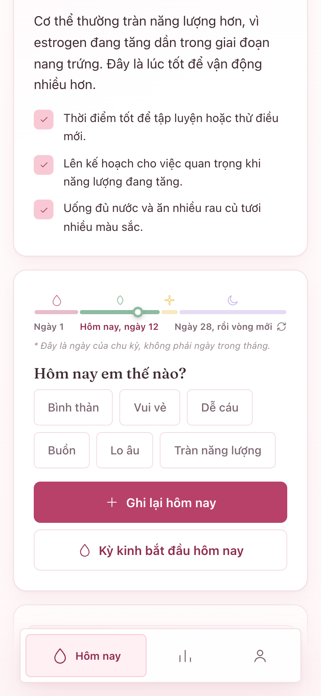<br /><sub><b>What to pay attention to</b><br />Phase note with simple tips</sub></td>
  </tr>
  <tr>
    <td align="center">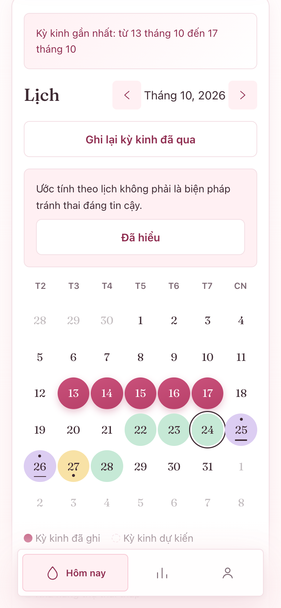<br /><sub><b>Calendar</b><br />Logged and predicted days</sub></td>
    <td align="center">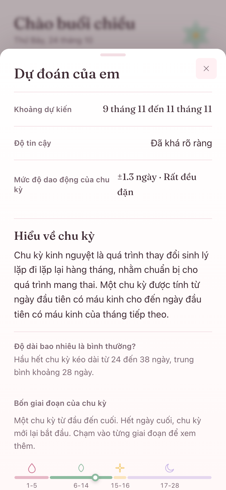<br /><sub><b>Prediction details</b><br />Range, confidence and the maths</sub></td>
    <td align="center">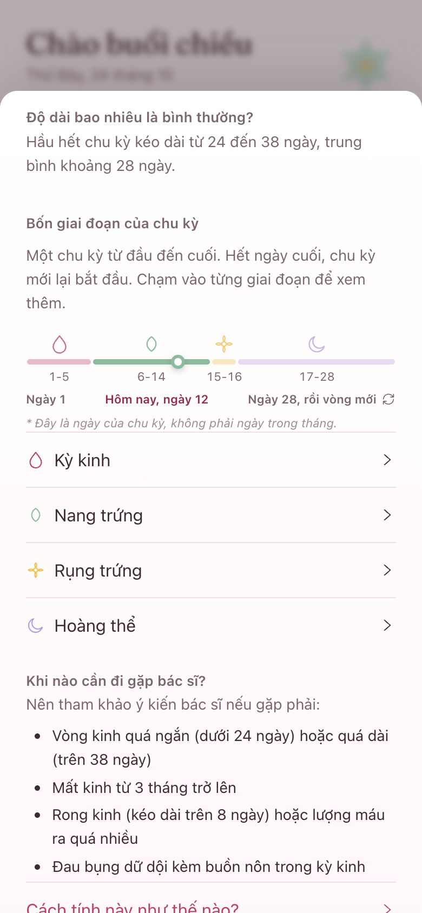<br /><sub><b>Learn</b><br />Cycle timeline, the four phases and when to see a doctor, inside the prediction sheet</sub></td>
  </tr>
  <tr>
    <td align="center">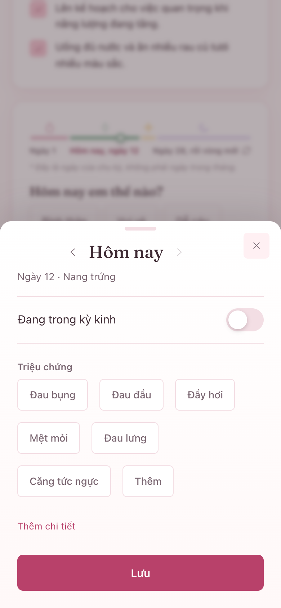<br /><sub><b>Log a day</b><br />Flow, symptoms, mood and notes</sub></td>
    <td align="center">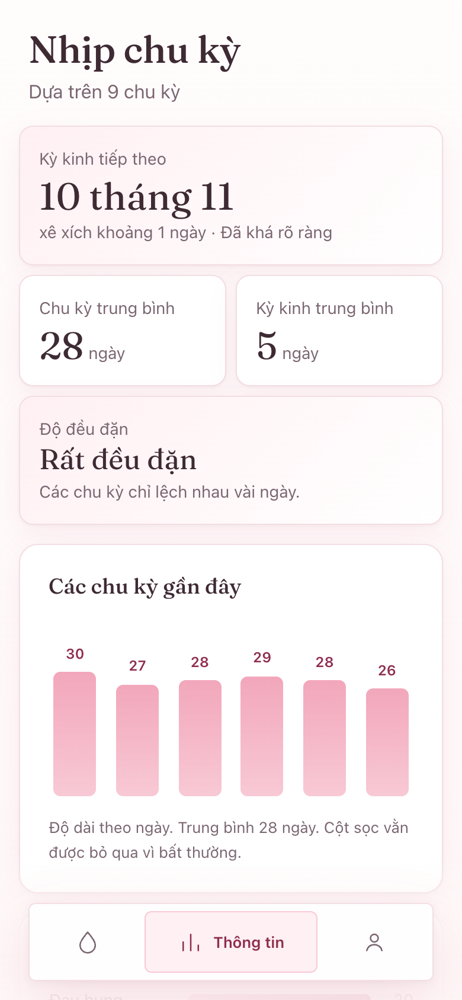<br /><sub><b>Insights</b><br />Averages, regularity and history</sub></td>
    <td align="center">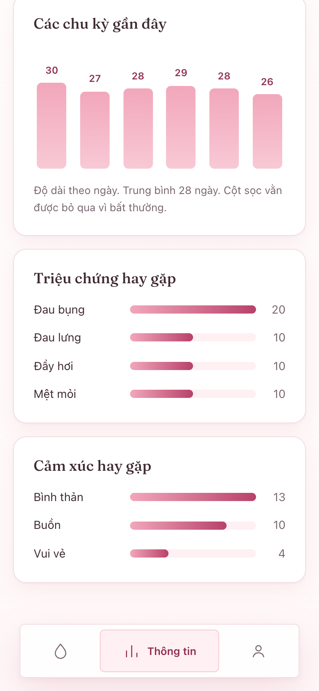<br /><sub><b>Patterns</b><br />Most common symptoms and moods</sub></td>
  </tr>
  <tr>
    <td align="center">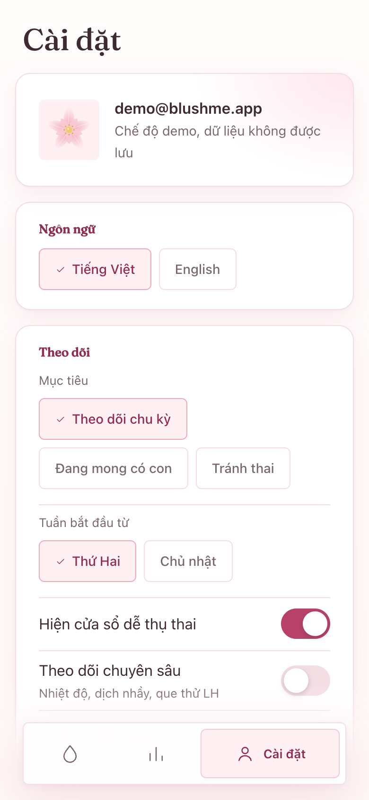<br /><sub><b>Settings</b><br />Language, goal and tracking options</sub></td>
    <td align="center">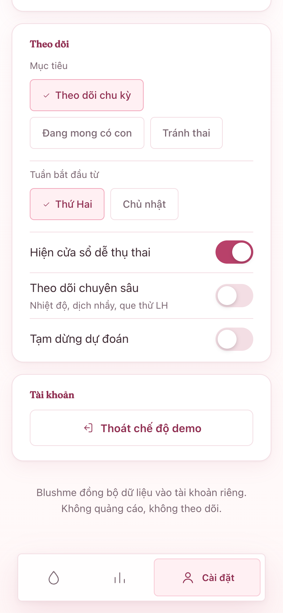<br /><sub><b>Data and account</b><br />Export, import, delete, sign out</sub></td>
    <td align="center"><sub>On wide screens the app sits in a centered phone-width frame:</sub><br /><br />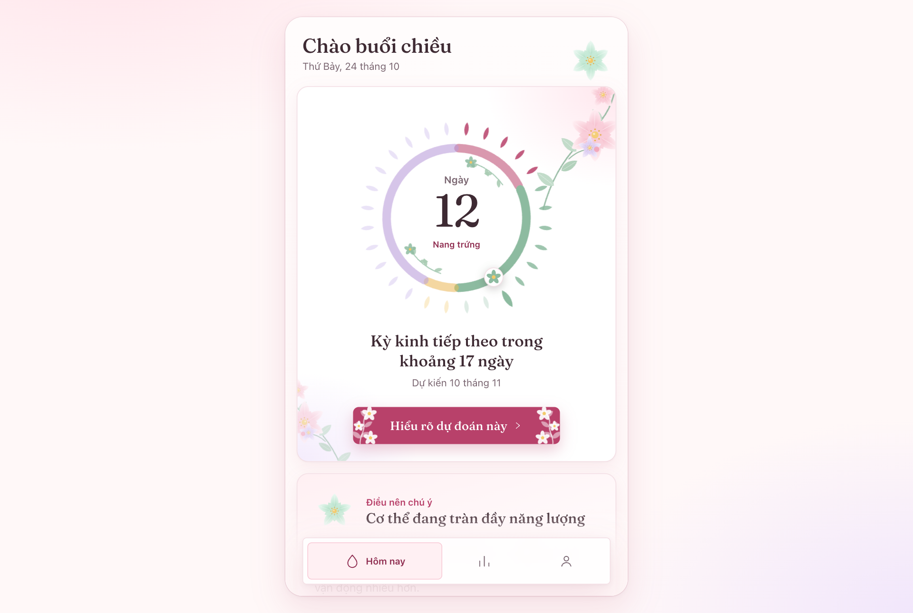</td>
  </tr>
</table>

## Features

| Area | What you get |
| --- | --- |
| **Today** | Cycle ring with one petal per day, current phase, countdown to the next period, greeting by time of day |
| **Logging** | One-tap mood, "my period started today" shortcut, full log sheet for flow, symptoms, notes and optional BBT, cervical mucus and LH tests |
| **Calendar** | Logged and predicted periods, optional fertile-window layer, range selection for past periods |
| **Insights** | Average cycle and period length, regularity, last six cycles, most common symptoms and moods |
| **Predictions** | Weighted, outlier-aware estimates with a confidence level and a "show the maths" view using your own numbers |
| **Accounts** | Sign up, sign in, sign out, export or delete your data, delete your account |
| **Design** | White and blush palette, botanical illustrations, calm motion that respects reduced-motion settings |

## Your cycle, explained

The ring on the Today screen colours each day by phase. The same names are used everywhere in the app (ring, timeline, focus card and the Learn sheet).

| Phase | In the app (vi / en) | Typical length | Ring colour |
| --- | --- | --- | --- |
| Menstrual | Kỳ kinh / Menstrual | 3 to 7 days | Rose |
| Follicular | Nang trứng / Follicular | Until ovulation | Green |
| Ovulation | Rụng trứng / Ovulation | About 3 days | Yellow |
| Luteal | Hoàng thể / Luteal | About 14 days | Lavender |

## Run it locally

### Requirements

| Tool | Version | Notes |
| --- | --- | --- |
| [Bun](https://bun.sh) | 1.x | Package manager and script runner |
| [Supabase](https://supabase.com) project | Free tier is enough | Provides auth and the database |

### 1. Install dependencies

```bash
bun install
```

### 2. Configure environment variables

```bash
cp .env.example .env.local
```

| Variable | Required | Description |
| --- | --- | --- |
| `VITE_SUPABASE_URL` | Yes | Your project URL, from Dashboard, Settings, API |
| `VITE_SUPABASE_PUBLISHABLE_KEY` | Yes | The publishable (anon) key. Never use a service role key here |
| `VITE_SITE_URL` | For deploys | Public origin used by the social share image, for example `https://blushme.example.com` |

### 3. Create the database

Open the Supabase **SQL Editor**, paste the contents of [`supabase/migrations/0001_blush_init.sql`](supabase/migrations/0001_blush_init.sql) and run it once.

| Created | Purpose |
| --- | --- |
| `cycle_settings` | One row of settings per user |
| `daily_logs` | One row per user per day |
| Row level security policies | A user can only read and write their own rows |
| `delete_my_account()` | Lets the app delete the signed-in user and all their data |

### 4. Start the app

```bash
bun run dev
```

Open the URL printed in the terminal (usually http://localhost:5173).

New accounts must confirm their email before signing in, which is Supabase's default. To skip this while developing, turn off **Confirm email** under Authentication, Providers, Email.

## Scripts

| Command | What it does |
| --- | --- |
| `bun run dev` | Start the Vite dev server |
| `bun run build` | Type-check and build for production |
| `bun run preview` | Serve the production build locally |
| `bun test` | Run the unit tests once |
| `bun run test:watch` | Run tests in watch mode |
| `bun run lint` | Lint the codebase |
| `bun run typecheck` | Type-check without emitting |
| `bun run tokens` | Regenerate `src/ui/tokens.css` from `DESIGN.md` |

## Tech stack

| Layer | Choice |
| --- | --- |
| UI | React 18, TypeScript (strict), Vite |
| State | Zustand |
| Backend | Supabase (auth and Postgres) |
| i18n | react-i18next (Vietnamese and English) |
| Motion | Framer Motion |
| Dates | date-fns |
| Testing | Vitest |
| PWA | vite-plugin-pwa |

## How predictions work

The prediction engine in `src/engine/` is pure TypeScript with no React, network or storage code, so every estimate is reproducible from your logs.

| Step | Rule |
| --- | --- |
| Valid cycles | Cycle lengths outside 21 to 45 days are ignored |
| Outliers | With 5 or more valid cycles, lengths far from the median are dropped |
| Weighting | The last 6 valid cycles count, newest weighted most (0.8 per step back) |
| Early on | With fewer than 3 valid cycles, your stated cycle length is blended in and confidence stays low |
| Ovulation | Temperature shift beats a positive LH test, which beats the calendar estimate |
| Dates | All date maths uses `date-fns` on `YYYY-MM-DD` strings to stay safe across DST and leap years |

## Project structure

| Path | Contents |
| --- | --- |
| `src/engine/` | Prediction logic and its tests |
| `src/data/` | Supabase access, settings types, demo data |
| `src/store/` | Zustand stores for auth, settings, logs and UI |
| `src/features/` | Screens: auth, onboarding, today, calendar, insights, settings, log |
| `src/ui/` | Design-system components and botanical illustrations |
| `src/i18n/` | Vietnamese and English strings (kept key-for-key identical) |
| `supabase/` | Database migration |
| `public/` | Icons, fonts and the social share image |
| `docs/screenshots/` | Images used in this README |
| `DESIGN.md` | Design system source of truth |

Design values live in the frontmatter of [`DESIGN.md`](DESIGN.md). After editing them, run `bun run tokens` to regenerate the CSS. See [`CLAUDE.md`](CLAUDE.md) for deeper architecture notes.

## Deploying

Build with `bun run build` and host the `dist/` folder on any static host.

| Where | What to set |
| --- | --- |
| Host environment | `VITE_SUPABASE_URL`, `VITE_SUPABASE_PUBLISHABLE_KEY`, `VITE_SITE_URL` |
| Supabase, Authentication, URL Configuration | Add your deployed URL so confirmation emails redirect correctly |

## Troubleshooting

| Symptom | Likely cause and fix |
| --- | --- |
| "Could not find the table `public.daily_logs`" | The migration has not been run. Run it in the Supabase SQL Editor |
| Sign-in says the email is not confirmed | Open the confirmation email, or disable **Confirm email** for development |
| Blank page or "Missing VITE_SUPABASE_URL" | `.env.local` is missing or the dev server was not restarted after editing it |
| Data does not save and a toast appears | No connection, or the migration is missing. The change is rolled back |
| Social preview image does not show | Set `VITE_SITE_URL` to an absolute URL and rebuild |

## Privacy and security

| Topic | Details |
| --- | --- |
| Data isolation | Row level security restricts every table to the signed-in user |
| Network | The app only talks to your Supabase project |
| Tracking | No analytics or third-party trackers |
| Control | Export, delete data or delete your account from Settings |
| Demo mode | Sample data stays in memory in your browser and is never saved |
